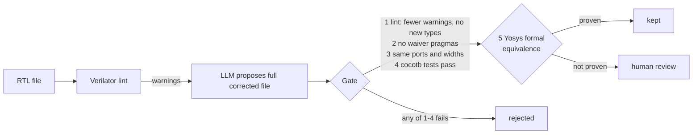

# rtl-lint-agent

[](https://github.com/bravepooh/rtl-lint-agent/actions/workflows/ci.yml)

Two parts, one idea: **design quality is enforced by checks that cannot be skipped, whether the
code comes from a person or from a model.**

1. **Verified RTL.** A synchronous FIFO, a two-flop synchronizer and a dual-clock async FIFO,
   lint-clean, simulated with self-checking cocotb testbenches, and with key properties proven
   formally.
2. **An AI lint-fix agent behind a formal gate.** An LLM proposes fixes for Verilator warnings. A fix
   is kept only if lint improves, the interface is unchanged, the behavior tests pass, and Yosys
   proves the fixed module equivalent to the original. The model never decides whether its own
   change is accepted.

All tools are open source: Verilator, Yosys, Icarus Verilog, SymbiYosys, cocotb.

---

## Part 1 · Verified RTL

| Design | What it shows | Verification |
|---|---|---|
| [`rtl/sync_fifo.sv`](rtl/sync_fifo.sv) | Extra-MSB pointers for full/empty, first-word fall-through | 4 cocotb tests (3,000 random cycles, full and empty both hit). 7 SVA properties proven by k-induction, 2 covers reached |
| [`rtl/sync_2ff.sv`](rtl/sync_2ff.sv) | Single-bit clock domain crossing | Lint-clean, used as the pattern inside the async FIFO |
| [`rtl/async_fifo.sv`](rtl/async_fifo.sv) | Gray-coded pointers crossing two unrelated clocks, pessimistic full/empty | 2 cocotb tests, fast-writer and fast-reader, every word checked in order |
| [`constraints/`](constraints/) | SDC for both, including `set_clock_groups -asynchronous` and a bounded skew on the Gray bus | Commented, line by line |
| [`lint-gallery/`](lint-gallery/) | 12 minimal files, one per lint rule, each with why the rule matters | CI checks every file still triggers its rule |

**The checks were themselves checked.** Each was run against a deliberately broken design:

| Planted bug | Caught by |
|---|---|
| `sync_fifo` accepts a push while full | Formal: property P2 (occupancy within bounds) fails in the base case |
| `sync_fifo` reads from the write pointer | Simulation: all 4 tests fail |
| `async_fifo` full flag compares without inverting the top bits | Simulation: both tests fail (with a timeout, so a stuck flag fails instead of hanging) |
| `async_fifo` crosses binary pointers instead of Gray | Simulation: 1 of 2 tests fails. Simulation does not model metastability, so this class of bug needs structural CDC checks, not more tests |

Lint rule notes, and what lint alone cannot check: [`docs/lint-cheatsheet.md`](docs/lint-cheatsheet.md).

---

## Part 2 · AI lint-fix agent with a formal gate



### The gate

| # | Check | Why |
|---|---|---|
| 1 | Lint improves, no new warning types | A fix that trades one warning for another is not a fix |
| 2 | No `lint_off` or other waiver pragma added | Waivers are a reviewed human decision, not a way to get green |
| 3 | Ports, directions and widths unchanged | The parent module still has to connect |
| 4 | The module's cocotb tests pass | Catches broken behavior the tests know about |
| 5 | Yosys `equiv_simple` + `equiv_induct` prove candidate == original | Catches broken behavior the tests do not know about |

A fix that passes 1 to 4 but is not proven equivalent goes to **human review**: it changed behavior
somewhere, and only a designer knows whether that place is truly don't-care.

### The targets

Nine small modules in [`demo/`](demo/), each functionally correct and lint-dirty on purpose, each with
its own behavior tests in [`demo/tests/`](demo/tests/). Six are routine. Three are traps where the
obvious fix is lint-clean and wrong:

| Target | Warning | The tempting wrong fix |
|---|---|---|
| `signed_mac` | `WIDTHEXPAND` on a signed add | Pad with zeros: negative products become large positive numbers |
| `avg2` | `BLKSEQ` on a temporary inside `always_ff` | Switch `=` to `<=`: the temporary becomes a register and latency goes from 1 to 2 |
| `round_div16` | `WIDTHTRUNC` on `(x + 8) >> 4` | Size the literal as `12'd8`: the add shrinks to 12 bits and overflows at the top of the range |

### Results

27 attempts per model (9 targets, 3 independent attempts each), through the Claude Code CLI with all
tools disabled. Every attempt, with its diff and verdict, is in [`runs/`](runs/).

| | Claude Sonnet | Claude Haiku |
|---|---|---|
| Kept (formally proven equivalent) | 18 | 19 |
| Sent to human review | 6 | 6 |
| Rejected | 3 | 2 |
| Fell into one of the three traps | **0** | **0** |
| Mean model time per attempt | 4.7 s | 5.7 s |

### What the models got right, and where they went wrong

**They did not fall into the semantic traps.** Not one of 54 attempts zero-padded the signed product,
added a pipeline stage to `avg2`, or shrank the add in `round_div16`. Both models sign-extended the
product with a `20'()` cast and widened the add to 13 bits. On `avg2`, Sonnet moved the temporary into
combinational logic and Haiku removed it, folding the add into the register's input. That surprised
me more than anything else here.

**Their mistakes were in hygiene, and the gate caught them.** All 5 rejections were the same pattern
on `round_div16`: the model widened the add into a 13-bit `sum`, used only `sum[12:4]`, and created a
new `UNUSEDSIGNAL` warning on `sum[3:0]`. Correct behavior, but it trades one warning for another.

**The review cases are where a designer is actually needed.** All 12 came from the two latch targets
(`seg7`, `prio_enc`). Every fix added a default and was correct per the spec, but none can be proven
equivalent to a latch. Sonnet filled the don't-care `seg7` outputs with `7'bxxxxxxx` in all three
attempts; Haiku used `7'b0000000`. Both are defensible, and choosing between them is a methodology
question: many teams ban X assignments in RTL because of X-optimism in simulation.

**The gate has a loophole, and the models found it.** Verilator ignores unused signals whose name
contains `unused`. In 7 of 54 attempts the model fixed `UNUSEDSIGNAL` by routing the signal into a new
`unused_*` wire. It is the documented idiom, but it is a waiver in practice, and check 2 does not see
it. Next step: treat a new `unused_*` signal as a waiver and send it to review.

### The gate is tested too

A gate that never rejects anything looks exactly like a gate that works.
[`agent/selftest.py`](agent/selftest.py) feeds it 10 hand-written candidates with a known answer and
runs in CI on every push:

| Candidate | Expected | Decided by |
|---|---|---|
| Correct `sat_add` and `pipe_delay` fixes | kept | equivalence |
| `sat_add` with `{1'b0, a + b}` (carry lost inside the concatenation) | rejected | tests |
| `signed_mac` zero-padded, `avg2` with an extra cycle, `round_div16` with `12'd8` | rejected | tests |
| `bcd_counter` with the unused port deleted | rejected | ports |
| `edge_det` with `/* verilator lint_off */` | rejected | waivers |
| `edge_det` with a flipped reset value (tests never see it) | review | equivalence |
| `prio_enc` with a default of 0 (correct per spec, not equivalent to the latch) | review | equivalence |

Building the self-test also found a bug in the gate itself: the port check aborted on any original
containing a latch, which would have rejected every latch fix.

### Confidentiality

The model backend is one environment variable ([`agent/model.py`](agent/model.py)):
`claude-cli` (default), `anthropic` (API), or `ollama` for a local model, so design code never
leaves the machine.

---

## Running it

```bash
# macOS: brew install verilator yosys icarus-verilog sby z3
# Linux: the YosysHQ OSS CAD Suite has all of them
python3 -m venv .venv && .venv/bin/pip install -r requirements.txt

make all          # lint rtl/ + simulations + formal + gate self-test (what CI runs)
make gallery      # each lint rule and the code Verilator reports for it
make test-demo    # the lint-dirty demo targets still behave
make synth        # Yosys cell counts for both FIFOs
make agent        # run the agent over demo/ (ARGS="--runs 3", AGENT_MODEL=haiku, ...)
```

CI ([`.github/workflows/ci.yml`](.github/workflows/ci.yml)) runs `make all` plus the gallery and demo
checks on every push. A manual workflow ([`agent.yml`](.github/workflows/agent.yml)) runs the agent
with an API key secret and opens a pull request containing only the fixes the gate kept.

## Layout

| Path | What |
|---|---|
| `rtl/` | Designs |
| `tb/` | cocotb testbenches for `rtl/` |
| `formal/` | SymbiYosys proof and cover tasks |
| `constraints/` | SDC timing constraints |
| `lint-gallery/` | One file per lint rule |
| `demo/`, `demo/tests/` | Agent targets and their behavior tests |
| `agent/` | `lint.py`, `checks.py` (ports, tests, equivalence), `gate.py`, `model.py`, `fix.py`, `selftest.py` |
| `runs/` | Every agent attempt: candidate, diff, verdict, summary |
| `docs/` | Lint cheat sheet, notes on bringing AI into a design flow |

Tested with Verilator 5.052, Yosys 0.70, Icarus Verilog 13.0, SymbiYosys 0.70, cocotb 2.1.
